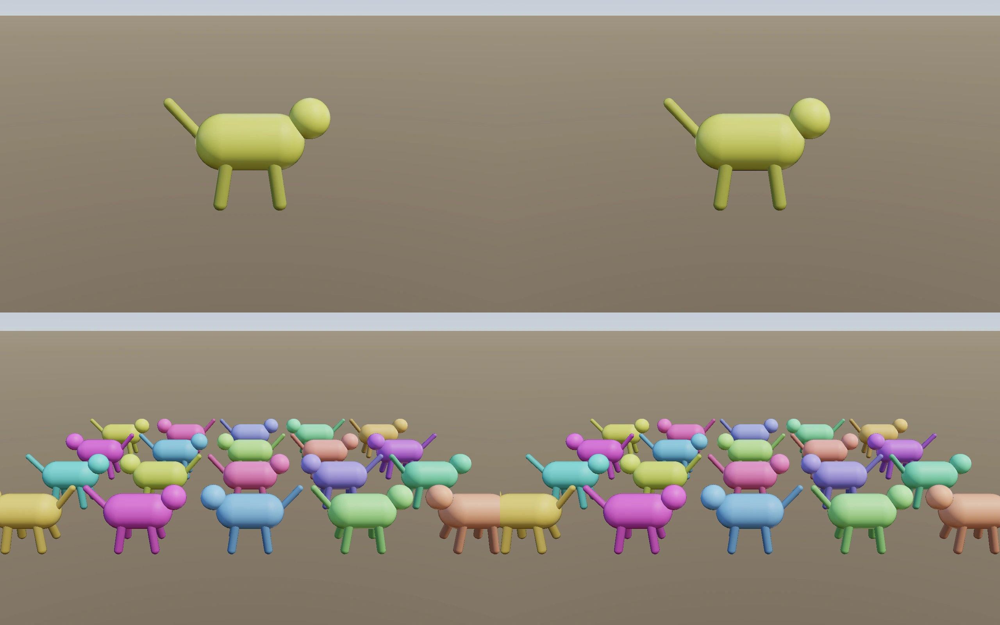
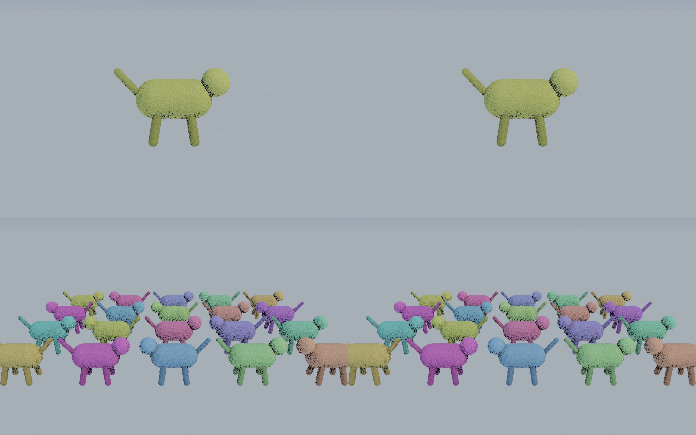

# Legacy and native Loft on capsules

Apple M4 Metal, macOS 15.5, wgpu 30.0.1. The legacy engine is `legacy/2026-11-19` at `acb7e8b`. The native engine is the starting `origin/main` at `1194779`. Both used 1280 × 800, fixed t = 0, one warmup, and 300 GPU-timestamped frames per case. Each timing block held the GPU lock and both compile locks.

## Measurements

Paired values give the first run and its repeat, in that order.

| Instance groups | Engine | GPU p95, ms | Cold device load, ms | Warm device load, ms | Shader modules | Pipelines | GPU commands/frame | Source tokens |
| ---: | --- | ---: | ---: | ---: | ---: | ---: | ---: | ---: |
| 1 | Legacy | 3.927 / 2.718 | 609.663 / 362.094 | 12.491 / 6.561 | 5 | 5 | 5 | 1,197 |
| 1 | Native | 2.973 / 2.269 | 513.708 / 607.304 | 5.568 / 2.607 | 4 | 5 | 5 | 621 |
| 20 | Legacy | 9.389 / 9.326 | 476.615 / 405.851 | 11.087 / 7.877 | 5 | 5 | 5 | 1,197 |
| 20 | Native | 2.798 / 1.019 | 449.818 / 470.712 | 2.070 / 1.828 | 4 | 5 | 5 | 621 |

Native p95 fell by 17–24% for one group and 70–89% for 20 groups. Warm device loads were lower at both counts in both runs. The cold device-load ordering reversed on the repeat. Native triangle-control p50 was 0.096 ms in both one-group runs and 0.036 / 0.030 ms in the 20-group runs, below the gate's 0.350 ms contention threshold. The native timing tail varied substantially even with those control readings.

Native source-to-device load was 535.338 / 622.789 ms cold and 15.078 / 10.376 ms warm for one group. For 20 groups it was 571.274 / 597.400 ms cold and 13.031 / 11.037 ms warm. The repeat timed the separate legacy Bun bundle builds at 270 ms and 80 ms wall time, including process startup and file output.

## Renders

Legacy is on the left and native is on the right. One group is on top and 20 groups below.

All four stills matched their repeat byte for byte. Both native t = 0 frames also matched the prior PF1 main RGBA hashes. Checksum verification passed for all 18 frozen gate references. [Native RGBA hashes](../../out/meta/x2d/native-pixels.txt) · [Reference verification](../../out/meta/x2d/references-after.log)

## Fixture and timing

- Each group has seven analytic capsules, including a zero-length capsule for the head. The endpoints, radii, layout, and palette formulas match. The legacy fixture in `tools/ab_legacy.sh` expresses the segment axis as row data because its ordered renderer places shapes by translation. Both cameras look at (0, 0.6, 0) along the same viewing direction with 40° vertical field of view. At t = 0 the camera is at x = 0, y = 1.8 + 0.6√count, z = 3.6 + 1.9√count. Legacy derives clip planes from camera distance. Native uses 0.05 and 400.
- Legacy uses the ordered `realtime()` engine with matte shading, one sampled bounce, ray-traced occlusion, four-sample visibility, and its default sky and film curve. Native uses indirect visibility, tile classification, dielectric GGX, fixed sky integration, and ACES presentation. The native capsules schedule has no shadow-map pass. These choices affect both the pictures and the GPU workload.
- GPU p95 is the sorted sample at zero-based index `round(0.95 × 299)`. Legacy spans its first camera timestamp through the last render pass. Native spans the first scheduled GPU pass through presentation and computes the camera on the CPU. GPU commands count draws and dispatches. The legacy count comes from the two named-camera dispatches, the emitted bundle’s draw schedule, and the profiler’s frame-kernel count. The native profiler records the count on every sampled frame.
- Cold and warm device loads are successive loads on one device with the same newly keyed shaders. Legacy uses `loft-draw profile --loads 2 --cold-nonce`, with the bundle read before the stopwatch and the output target created after it. Native uses the Load gate’s device phase, which includes its sized resources. Both exclude adapter/device acquisition and the source frontend from the table. Source counts use `o200k_base` on the entire authored file, including the inline legacy hit function and excluding imported libraries.

Run `tools/ab_legacy.sh LEGACY_WORKTREE NEW_OUTPUT_DIRECTORY` from the lane checkout. The paired profiles, load reports, and lossless stills are under `out/meta/x2d/`. [Measurements JSON](../../out/meta/x2d/results.json) · [Lane record](lanes/x2d.md)

## Matched comparisons

The four configurations use the same seven capsules per group, palette, sun direction and power,
pinhole pose and 40° field of view as the original fixture. Both render 1280 × 800 at fixed
t = 0. Clip planes retain the difference described above. The fixture has no geometry near
either clipping plane. The matched legacy fixture recenters its capsule quadratics on the
ray before solving, as the native fixture already does. This keeps thin, distant capsules'
secondary ray origins on the surface. The original benchmark above retains its original
intersection arithmetic.

**A. Reduce legacy to native's realtime workload.** Compose the tag's `world`, `find`,
`shadePixel` and `resolve` with one visibility sample, an empty shadow world and a direct
shader without path sampling. The shader evaluates the native dielectric at roughness 0.55
using the corresponding two rows of the native GGX energy table. It uses the same normal and
local AO taps, sun and 12 fixed sky directions, background and ACES fit as shipped native.
Legacy writes sRGB with the shader into UNORM. Native uses an sRGB target.

**B. Raise native to legacy's realtime workload.** Legacy runs the original `realtime()`.
The authored [native schedule](../../engines/realtime_matched.loft) uses the same Lambertian
BRDF, pixel-indexed PCG draw, one cosine-distributed diffuse ray, an analytic sun visibility
ray, and the legacy sky and Reinhard-to-sRGB film curve. At depth one, a secondary surface
supplies emission only. Every capsule here is matte and nonemissive.

Native's raster schedule has a single-sample Vis64 and its `shade_tiles` callback receives
a BSDF and lighting vectors without a hit, pixel coordinate or world query context.
`screen_pass` exposes world rays but replaces the raster schedule with a full-screen draw.
The recipe uses four software visibility taps, groups them by hit row, and shades each distinct
row once at pixel center when possible. Legacy uses the multisampled raster proxy and shades
its covered rows at pixel center. Its capsule hit shader runs at pixel frequency. Native uses
its BVH for coverage, sun and bounce queries. The B fixture uses a two-root capsule
intersection so rays originating inside overlapping capsules can hit the exit surface.
Legacy traverses rows in order for secondary visibility and computes analytic normals.
Native reconstructs normals with finite differences. The native screen pass has a fixed ACES output transform and sRGB target. The
recipe inverse-maps the Reinhard result through that ACES fit and keeps the intermediate in
f32. Loft's WGSL validator rejects `pack2x16float` here because the shader lacks the
`SHADER_FLOAT16_IN_FLOAT32` capability. Legacy rounds through an RGBA16F attachment.

Before timing, the expected picture is the same sky, tones and silhouette at both group counts,
with residuals concentrated on edges, overlaps and ray grazing angles. The prediction is above
35 dB whole-frame RGB PSNR for both pairs. A should issue five GPU commands in both engines and
take less GPU time than the original legacy recipe at 20 groups. B should issue one native
command instead of five legacy commands. Four full-screen BVH coverage queries per pixel may
outweigh the reduced command count for a single group, while legacy's linear secondary-ray
cost should grow faster with group count.

### Paired timings and image evidence

Apple M4 Metal, macOS 15.5, wgpu 30.0.1. Cells separated by a slash give runs 1 and 2.
Every frame profile used one warmup and 300 timed frames. The second sweep reversed
the scene, pair and engine order. The entire sweep held the GPU lock and both shared
compile slots. Cold and warm load reuse one device and a fresh shader key per pair.
The device load scopes and GPU timestamp spans retain the differences described above.
B schedules one native draw. Its native loader creates five pipelines.
Token counts use `o200k_base` on the compiled fixtures and any new authored engine code.
Existing library imports and the generated GGX table values are excluded.

#### A · Reduced lighting

| Groups | Engine | GPU p95, ms | Cold load, ms | Warm load, ms | Modules | Pipelines | Commands/frame | Tokens |
| ---: | --- | ---: | ---: | ---: | ---: | ---: | ---: | ---: |
| 1 | Legacy | 10.062 / 11.671 | 517.239 / 738.793 | 11.812 / 20.858 | 5 | 5 | 5 | 3608 |
| 1 | Native | 9.573 / 10.606 | 573.663 / 1137.789 | 3.020 / 5.013 | 4 | 5 | 5 | 621 |
| 20 | Legacy | 11.000 / 11.660 | 376.020 / 714.693 | 9.427 / 32.171 | 5 | 5 | 5 | 3608 |
| 20 | Native | 10.465 / 12.373 | 495.785 / 1506.998 | 2.086 / 3.208 | 4 | 5 | 5 | 621 |

#### B · Legacy lighting

| Groups | Engine | GPU p95, ms | Cold load, ms | Warm load, ms | Modules | Pipelines | Commands/frame | Tokens |
| ---: | --- | ---: | ---: | ---: | ---: | ---: | ---: | ---: |
| 1 | Legacy | 11.202 / 11.739 | 418.100 / 788.057 | 8.359 / 15.258 | 5 | 5 | 5 | 1228 |
| 1 | Native | 14.960 / 14.752 | 536.097 / 1296.021 | 5.154 / 8.016 | 4 | 5 | 1 | 2751 |
| 20 | Legacy | 26.608 / 28.903 | 872.956 / 816.635 | 30.325 / 30.421 | 5 | 5 | 5 | 1228 |
| 20 | Native | 58.269 / 56.205 | 2368.125 / 2082.091 | 14.338 / 13.084 | 4 | 5 | 1 | 2751 |

Whole-frame RGB metrics use the lossless 8-bit stills. The eight images each reproduced
their decoded RGB exactly on the repeat. Both pairs are visually equivalent at frame scale.

| Pair | Groups | PSNR, dB | Mean absolute difference, 0–255 | Pixels with any RGB channel over 2 | Native triangle-control p50, ms |
| --- | ---: | ---: | ---: | ---: | ---: |
| A | 1 | 47.52 | 0.037 | 0.010% | 0.762 / 0.974 |
| A | 20 | 55.70 | 0.029 | 0.014% | 0.557 / 0.850 |
| B | 1 | 47.26 | 0.028 | 0.125% | 0.926 / 0.670 |
| B | 20 | 37.04 | 0.235 | 0.966% | 0.315 / 0.612 |

Legacy is on the left in both sheets. One group is on top and 20 are below.

A's residuals are isolated to silhouette pixels and small precision differences in
normal reconstruction and sRGB rounding. B has a softer coverage edge and local
changes in single-sample shadow and bounce noise, most visible at overlaps and on
thin legs and tails in the 20-group image.

### What the timing isolates

The triangle control exceeded the 0.350 ms gate cutoff in seven of eight native profiles.
Both compile slots were held, and the process inventories at both ends contain no compiler
processes. The measurements show both repeats under the system GPU load present at the
time. Machine GPU utilization remained at 100% throughout a follow-up sampling window,
so these are the two recorded sweeps. Treat the differences below as observed deltas.

- **A · At 20 groups, the lighting workload explains almost all of the observed gain.**
  Reducing the legacy engine saved 15.61 / 17.24 ms. With reduced lighting on both engines,
  native saved 0.54 ms in run one and cost 0.71 ms in run two. At one group, the legacy
  workload change saved 1.14 / 0.07 ms and the native architecture saved 0.49 / 1.07 ms.
  Contention and the reversal at 20 groups prevent a stable architecture estimate.
- **B · Bringing the lighting back makes this native software path slower.** At 20 groups
  the matched native path cost 31.66 / 27.30 ms more than legacy. Using the shipped
  native workload saved 47.80 / 43.83 ms relative to this heavier native path. At one
  group the corresponding costs were 3.76 / 3.01 ms and the savings were 5.39 / 4.15 ms.
  The full-screen coverage queries and the legacy raster proxy have different execution
  costs, so these numbers describe the available authored path under the observed load.

Each decomposition compares its own run's p95s. Both start with the same legacy-full to
native-reduced gap and change one side's feature workload first.

Run `tools/ab_legacy.sh LEGACY_WORKTREE NEW_OUTPUT_DIRECTORY --matched` with the legacy
dependencies installed. The [paired measurements and frame hashes](ab2/results.json) accompany
the q95 sheets. [Lossless frames and raw logs](../../out/meta/ab2/) are preserved locally.

The shipped gate produced 18/18 exact RGBA hashes against the previously scored X2 main.
Twin held 36/36 and Truth held 34/34. The separate Speed gate flagged all six cases as
contended. The Pictures gate still compares against the older owner-approved pins.
[Shipped frame hash comparison](../../out/meta/ab2-checks/hashes.log)

The workspace native suite passed 153/154 tests. The existing Tier 0 promotion timing
test measured 0.805 ms p95 overhead against its 0.500 ms budget, with zero image
differences above 1/255. That test also missed on X2 main.
[Workspace test log](../../out/meta/ab2-checks/workspace-gpu-tests.log)
