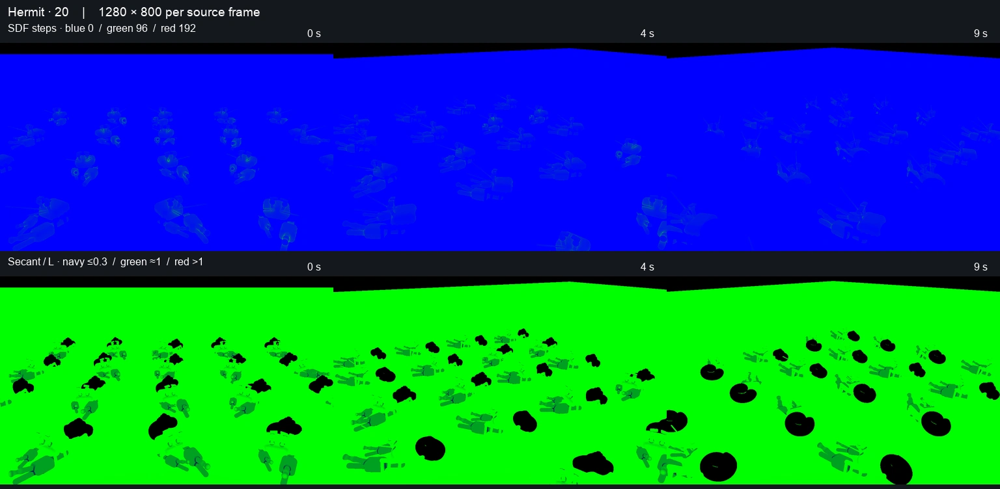
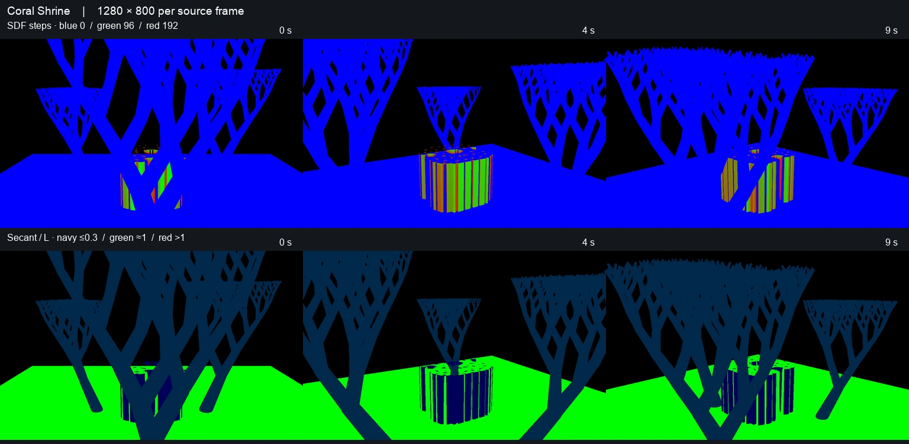

# PF1 · Where the M4 spends a frame

The historical p95s were 5.461 ms for Hermit-20 and 3.904 ms for Coral Shrine. Unmodified main at `173d6e9` scored **5.585 and 3.958 ms**. Hermit spends the largest share in lighting. Shrine spends it intersecting primary geometry.

## Two baseline profiles

Apple M4, Metal, macOS 15.5, single sample, 1280 × 800. Hermit used `count=20` and 300 consecutive orbit frames at 60 Hz. Shrine used `shrine_distance=6.4`, `shrine_solid=0` and 100 frames at t=0. Both used 30 warmups and `--timestamps ring`. Every run held `tools/gpu_lock.sh`. The triangle controls were 0.096 / 0.096 ms against the repository’s 0.350 ms contention threshold. Hermit issued 17 draws/dispatches and Shrine issued 12.

| GPU ms | Hermit p50 | Hermit p95 | Shrine p50 | Shrine p95 |
|---|---:|---:|---:|---:|
| Cull | .004 | .005 | .009 | .009 |
| Vis | 1.417 | 1.735 | 2.150 | 2.684 |
| Shadow | .649 | 1.225 | .461 | .678 |
| Classify | .000 | .170 | .000 | .075 |
| Shade | 2.188 | 3.096 | .397 | .869 |
| Present | .173 | .549 | .189 | .307 |
| **First start to last end** | **4.511** | **5.585** | **3.190** | **3.958** |

`loft profile --json` attributes time between consecutive pass ends, clamping negative increments to zero. Metal overlaps pass intervals. Classify’s own start-to-end median was .630/.355 ms, much of it concurrent with Shadow. Present’s raw interval includes time waiting for Shade. Each column gives marginal quantiles. Adding its entries does not reconstruct the frame quantile. The archive contains the actual start/end pairs for every frame.

| Module | WGSL lines | ALU | Trans. | Storage loads / stores | Texture sites | Loop depth | Branches | Calls | Workgroup B |
|---|---:|---:|---:|---:|---:|---:|---:|---:|---:|
| Ground | 486 | 403 | 6 | 17 / 4 | 10 | 1 | 33 | 68 | 0 |
| HermitShell | 594 | 716 | 29 | 45 / 5 | 10 | 1 | 36 | 110 | 0 |
| CrabFace | 607 | 556 | 7 | 35 / 4 | 10 | 1 | 38 | 90 | 0 |
| CrusherClaw | 603 | 560 | 8 | 34 / 4 | 10 | 1 | 38 | 92 | 0 |
| CrabLeg | 596 | 504 | 8 | 43 / 4 | 10 | 1 | 44 | 76 | 0 |
| cull · both | 79 | 30 | 0 | 2 / 1 | 0 | 1 | 10 | 0 | 0 |
| classify · both | 75 | 17 | 0 | 0 / 1 | 1 | 1 | 7 | 0 | 4 |
| present · hermit | 84 | 43 | 4 | 3 / 0 | 2 | 0 | 3 | 4 | 0 |
| ShrineFloor | 373 | 327 | 3 | 12 / 4 | 10 | 1 | 26 | 49 | 0 |
| FoldedLantern | 328 | 270 | 0 | 24 / 4 | 10 | 1 | 25 | 39 | 0 |
| CoralBranch | 393 | 345 | 3 | 25 / 4 | 10 | 1 | 35 | 43 | 0 |
| SolidLanternProxy | 319 | 244 | 0 | 23 / 4 | 10 | 1 | 24 | 35 | 0 |
| present · shrine | 112 | 81 | 7 | 3 / 0 | 3 | 1 | 5 | 6 | 0 |

Naga visits reachable functions once across **all** entries in a module, including twin and load-time bake entries. A texture site inside four loop iterations issues four requests. Vector ALU expressions count once. The telemetry supplies code shape. The paired substitutions below supply cost.

## What the AOVs measure

Each sheet shows the full camera at 0, 4 and 9 seconds. Statistics use decoded 1280 × 800 diagnostic PNGs before WebP compression. The step palette encodes 0–192 iterations. Black is sky, blue is zero steps on analytic or raster hits. The ratio color comes from a finite-difference directional secant divided by the row bound. Raster surfaces have no field ratio. The bottom palette bin includes values that round to the threshold color.

| Visible traced hits | Count | Steps mean | p50 | p95 | Max | Lowest ratio bin |
|---|---:|---:|---:|---:|---:|---:|
| Hermit 0 s | 118,934 | 11.1 | 9 | 23 | 144 | 42 |
| Hermit 4 s | 129,527 | 8.9 | 8 | 18 | 109 | 35 |
| Hermit 9 s | 83,363 | 8.0 | 7 | 15 | 63 | 2 |
| Shrine 0 s | 13,131 | 129.7 | 129 | 182 | 192 | 13,131 |
| Shrine 4 s | 49,381 | 135.3 | 131 | 184 | 192 | 49,381 |
| Shrine 9 s | 35,567 | 141.5 | 142 | 190 | 192 | 35,567 |

At 0 s the final visible hits alone account for about 1.32 million field evaluations on Hermit and 1.70 million on Shrine. The images omit misses, hidden fragments and the sun view. They cannot measure active lanes per SIMDgroup. Shrine’s dark analytic branches do zero march iterations. Restricting the ratio histogram to traced hits prevents interpreting those branches as an SDF opportunity.





## Byte accounting

Use N = 1,024,000 screen pixels, M = 1,048,576 shadow texels, I = all instance rows, S = camera survivors, T = all (kind, tile) pairs, H = winning non-sky pixels. Sizes below are logical resource payloads per screen pixel. They distinguish repeated shader requests, attachment formats, and the store/discard actions. Texture caching, compression, vertex reuse and selected-component loads make physical transactions device-dependent.

| Pass | Reads | Writes |
|---|---|---|
| Cull | 32I/N B of instance bounds/IDs, 4S/N B of kind bases, and 4S/N B of atomic counter reads. Frame transform is uniform. | 4S/N B of visible indices and 4S/N B of indirect counter updates. Camera argument resets arrive by queue write outside the pass. |
| Vis | 16 B per indirect nonindexed draw, 20 B per indexed draw, 4 B per vertex instance-list lookup and the kind’s live row fields. Hermit’s shell also reads 4 B per index and a 16 B position slot per indexed vertex. Depth tests use a 4 B attachment. Raster overdraw and the post-transform cache determine invocation counts. | RG32Uint Vis stores 8 B/px including clear. D32 uses 4 B/sample during raster and is discarded. MSAA is 1×. |
| Shadow | Same geometry reads from the sun, with an identity row list for every caster. Hermit draws shell, face, claw and leg. Shrine draws floor, solid proxy and branches. | D32 stores 4M/N = 4.096 B/px. Sun Vis uses 8 B/shadow texel during raster and is discarded. |
| Classify | One RG32Uint Vis load per screen pixel, 8 B/px of formatted texels, 4 B/px of IDs consumed. One 4 B atomic counter read per resulting kind/tile pair. | Per kind/tile pair, 4 B list entry and 4 B atomic counter update, or 8T/N B/px. One 4 B workgroup mask per 8×8 tile. |
| Shade | 64T Vis loads, or 512T/N B/px. One unique 4 B tile index per listed group, addressed by 64 lanes. 12 B of indirect args per scheduled kind. Row fields, scan/energy LUTs and light uniforms depend on the winning kind. Up to nine bilinear comparison requests per shadowed hit, each accessing up to four 4 B depth texels before cache reuse. Main depth has no shader binding. | One RGBA16Float store per winning pixel, 8H/N B/px. Sky lanes return before the store. |
| Present | At source, one 8 B HDR load plus one 8 B Vis load on Hermit. Shrine also consults four Vis neighbors, giving 8 + 5×8 = 48 B/px. Each Vis load uses the ID word. The HDR value is dead on sky. | One 4 B RGBA8 sRGB output per pixel. Readback used for pictures occurs after timing. |

Whole row sizes in module order were 32/88/104/100/136 B on Hermit and 28/80/84/76 B on Shrine. Load sites can share fields, and dead row fields can disappear. Multiplying the whole row stride by every pixel would overstate the known traffic. Hermit’s GGX energy helper addresses a 1,122-word table with six scalar lookup sites per interpolation, some dead when only the first component is demanded. The shadow footprint is nine comparison calls even when their 2×2 texel neighborhoods overlap. At t=0, summing one whole row per winning shade lane gives source payload ceilings of 52.333/39.970 B/px before field elimination. The Hermit shell index stream contributes 2.592 B/px to Vis for 18 camera survivors and 2.880 B/px for 20 sun casters, before vertex/index cache reuse.

### Measured coverage at t=0

The GPU’s indirect X counts matched an independent census of the raw Vis words in all 16,000 tiles at 0, 4 and 9 s. At t=0 Hermit’s tile counts in module order were **12,529 / 1,026 / 1,350 / 1,352 / 3,100**. Shrine’s were **4,844 / 370 / 6,648 / 0**. Its solid shadow proxy never dispatches camera shading.

| Logical traffic per screen pixel at t=0 | Hermit | Shrine |
|---|---:|---:|
| Cull I / S (rows) | 321 / 293 | 3,072 / 2,561 |
| Cull reads / writes (B/px) | .0123 / .0023 | .1160 / .0200 |
| Listed tiles T / covered pixels H | 19,357 / 968,960 | 11,862 / 683,346 |
| Classify counter + list writes (B/px) | .1512 | .0927 |
| Shade Vis loads, measured | 1,238,848 | 759,168 |
| Shade Vis loads if full-screen per active kind | 5,120,000 | 3,072,000 |
| Shade Vis footprint (B/px) | 9.679 | 5.931 |
| HDR writes + full-screen source reads (B/px) | 7.570 + 8.000 | 5.339 + 8.000 |
| Source Vis loads across Classify + Shade + Present | 3,286,848 | 6,903,168 |

Shrine’s larger final Vis count comes from the woodblock outline’s four neighbor taps. Hermit writes 7.752 MB of HDR texels and Shrine 5.467 MB. Each source-level full-screen HDR read spans 8.192 MB. The separately allocated Metal texture and the compute-to-render dependency establish that the intermediate is materialized. Tile residency, cache hits, and external bytes are distinct questions.

## Isolated probes

Each A/B used two resident scenes on one Metal device and queue, built from the same original program. A, B, B, A each ran its own triangle control, warmups and complete replay. The two B blocks reused the same treatment object. All image and indirect argument readbacks occurred outside the timed intervals. The sign below is control minus treatment. Each number averages the two order-reversed differences of arm quantiles. See the per-arm results for drift before interpreting small values.

| Treatment (named metric) | Hermit A → B p50 | Hermit frame gain p50 / p95 | Shrine A → B p50 | Shrine frame gain p50 / p95 |
|---|---:|---:|---:|---:|
| Unchecked Shade (Shade) | 2.343 → 2.146 | +0.154 / -0.121 | 0.424 → 0.415 | +0.013 / -1.964 |
| Unchecked traced FS (Vis) | 1.682 → 1.482 | +0.092 / +0.800 | 2.370 → 2.061 | +0.318 / +0.324 |
| Traced FS, loop guard off (Vis) | 1.649 → 1.515 | +0.115 / +0.079 | 2.282 → 2.009 | +0.210 / -0.018 |
| Four march steps per outer loop (Vis) | 1.667 → 1.474 | +0.429 / -2.046 | 2.414 → 2.030 | +0.385 / +0.420 |
| Force full-screen per kind (Shade) | 2.819 → 2.738 | +0.139 / +0.029 | 0.513 → 0.547 | -0.110 / +0.046 |
| Contraction off (Shade) | 2.734 → 2.918 | -0.166 / -0.862 | 0.431 → 0.464 | -0.002 / +0.156 |
| Double HDR texel width (Present) | 0.167 → 0.263 | +0.012 / -0.074 | 0.185 → 0.259 | -0.031 / -1.169 |
| Read one HDR texel in post (Present) | 0.161 → 0.050 | -0.011 / -0.096 | 0.180 → 0.162 | -0.070 / +0.330 |
| Remove HDR dependency¹ (Present) | 0.164 → 0.000 | +2.556 / +2.275 | 0.182 → 0.000 | +0.186 / -0.127 |
| Reuse static shadow (frame) | 5.018 → 4.454 | +0.564 / +0.428 | 3.391 → 2.931 | +0.459 / -0.062 |
| Omit twelve sky samples (Shade) | 2.441 → 0.899 | +1.431 / +1.757 | — | — |
| Replace ground fBM with constant (Shade) | 2.501 → 2.434 | -0.216 / +0.096 | — | — |
| Unroll all lighting samples (Shade) | 2.424 → 2.068 | +0.464 / +0.199 | — | — |
| Share twelve sky colors per tile (Shade) | 2.493 → 2.509 | -0.261 / -0.181 | — | — |
| Double lantern march distance (Vis) | — | — | 2.246 → 1.982 | +0.286 / +0.269 |
| Skip primary lantern march (Vis) | — | — | 2.264 → 1.198 | +1.104 / +1.101 |
| Omit primary branch draw (Vis) | — | — | 2.238 → 1.280 | +1.116 / +1.247 |

¹ Bypass uses the CLI’s last-Present clock here. The latest-end correction appears below. A dash indicates a scene without a targeted trial. Positive gain means less time.

The measurements retain triangle medians and quantiles for every arm in run order. Frame tails varied even with the GPU lock. For example, one Shrine unchecked-Shade treatment block had an 8.021 ms p95 beside 4.079 ms in the other block. The triangle threshold detects gross contention and does not remove clock, scheduling or thermal drift. [Arm measurements](pf1/measurements.json)

**Runtime checks.** Under `~/.cargo/registry/src/`, `wgpu-30.0.1/src/api/device.rs` exposes `Device::create_shader_module_trusted` and `wgpu-types-30.0.1/src/shader.rs` defines `ShaderRuntimeChecks::unchecked()`. The pinned Metal HAL selects Naga’s buffer/index/image-load policy and loop bounding from these flags. Workgroup initialization comes from a separate pipeline option. PF1 created a second module and passed it only to the compute Shade entry, then in a separate experiment only to the **fragment** entry of traced draws. The vertex pipelines and other entries stayed checked. The second test covers Face and Claw in both Hermit cameras and FoldedLantern in Shrine’s main camera. Neither beauty schedule executes BVH traversal. The historical 19.4 ms per-hit BVH experiment uses a different schedule.

All-shade unchecked saved .197 ms of Hermit Shade and .009 ms of Shrine Shade. Hermit changed **82/92/106 pixels** at 0/4/9 s. Traced-fragment unchecked saved .199 ms of primary Vis and .122 ms of Shadow on Hermit, with **88/110/67 pixels** changed. Its .800 ms whole-frame p95 difference exceeds the targeted pass improvement and the frame medians reversed sign in one order. Those Hermit variants fail picture parity. On Shrine, traced-fragment unchecked saved .309 ms of Vis and .318 ms median frame time. The more selective loop test below separates the injected loop guard from the rest of the trusted-module switch.

**Tiles.** The fullscreen control dispatched every active kind over 160 × 100 groups, retaining Classify and the same per-pixel ID guard. The two full-screen schedules performed 3.88 million and 2.31 million extra Vis loads at t=0. Hermit’s whole-frame deltas reversed sign with run order. Shrine’s full-screen treatment cost .110 ms at the frame median. Both shipping schedules already classify once and dispatch an indirect list per kind. Building the proposed tile lists a second time has **0 ms available**.

**Contraction.** Captures taken immediately before the HAL’s Metal library call contain five Hermit and four Shrine Shade entry variants, including the unscheduled Shrine proxy. All have MSL 3.2, `MTLMathModeFast` and `preserveInvariance=true`. The original shading MSL has zero explicit `metal::fma` calls and no contraction override. With these exact settings, a buffer-fed f32 witness evaluated `(1+2⁻²³)(1−2⁻²³)−1` to bits `a8800000` (−2⁻⁴⁶). Forcing `#pragma METAL fp contract(off)` produced zero. Forcing `fast` reproduced the default. For the scene timing only Shade received the off pragma. It cost .184/.033 ms of Hermit/Shrine Shade. Enabling contraction in shading has **0 ms available**. Individual machine instruction counts are unavailable. [Apple Metal Shading Language Specification, §1.6.3](https://developer.apple.com/metal/Metal-Shading-Language-Specification.pdf)

**HDR dependency.** Widening only the HDR texture and its storage binding from 8 to 16 B/texel added .097/.074 ms to the Present median. Frame median differences were +.012/−.031 ms saved, inside run-order variation. The wider format changes rounding. A second probe substituted a uniform for the HDR read, keeping the Shade pass and its stores. This broke the GPU dependency. Present ended before Shade in **598/600** Hermit and **193/200** Shrine treatment frames. The CLI’s apparent 2.556/.186 ms median benefit becomes .145/−.091 ms using the *latest* pass end of each frame. Removing a dependency invalidates last-Present as a frame-completion marker.

**Counters.** Xcode GPU limiter and external-memory counters are **not scriptable on this host**. The `xctrace` shim requires full Xcode, `xcode-select` points to CommandLineTools, and this device’s public Metal `counterSets` returned only `timestamp: GPUTimestamp`. We can establish the HDR store/load dependency, count formatted bytes and perturb traffic. The fraction that actually traverses DRAM is unknown.

## Owning work

**Hermit-20 — lighting ALU and its dependent BSDF table lookups.** Shade takes 2.188 ms versus 1.417 ms of Vis. Keeping emission and the sun while omitting the twelve sky samples saves **1.542 ms of Shade and 1.431 ms of frame p50**. Geometry, Vis dispatch, HDR format, tile counts and the final store stay the same. Two ground fBM calls replaced by a constant saved only .066 ms of Shade, with whole-frame median regression. The strongest actionable lighting experiment kept all 14 evaluations in order and expanded the constant loop. It saved **.356 ms of Shade, .464 ms frame p50 and .199 ms frame p95**, but changed **29/13/16 pixels**. Preserving authored sample order alone does not ensure Metal rounding parity. “ALU” is a workload attribution to BSDF evaluation, including its small LUT. The available counters do not split arithmetic issue from on-chip lookup stalls.

**Coral Shrine — primary visibility, split between step-limited SDF work and analytic intersections.** Vis takes 2.150 ms of a 3.190 ms median frame. Keeping the lantern draw but discarding before the march saved **1.066 ms Vis**. Omitting only the visible branch draw saved **.957 ms Vis**, with the same 3,069 branches in the shadow world. The two independent ablations can change overlap and occlusion. FoldedLantern’s derived L is **22.871492**. Halving it saved **.264 ms Vis and .286 ms frame p50** but changed **11,705/37,019/20,858 pixels**. The old 192-iteration cap and hit tolerance help define the current picture. The 3,069 analytic branches use a closed-form cone/cap intersection and take **zero** sphere-trace steps. These costs support a steps/visibility diagnosis with an almost equally large analytic workload. SIMD divergence itself remains unmeasured. The shaded material, HDR transfer and shader checks each account for less time than either primary-visibility ablation.

## Ranked work for Sol

Savings below are median milliseconds for a single change. Each lane scores whole-frame p95 independently. The lanes overlap on Hermit’s shadow work, so adding their forecasts would double-count part of the benefit.

| Scene / rank | Change | Predicted saving | Basis and p95 evidence |
|---|---|---:|---|
| Hermit 1 | Reuse invariant sun map | **0.56 ms/frame** | **Measured.** Identical shader, caster world and map, populated before timing. The two order-specific frame median savings were .606/.522 ms. ABBA p95 saved .428 ms and steady-state commands fell 17→13. |
| Hermit 2 | Group only the tail of long marches | **0.01 ms** Vis + Shadow | **Derived.** A checked four-step loop saved .192/.133 ms of Vis/Shadow medians. At t=0 only 3.585% of successful steps lie beyond step 24. (.192+.133)×.03585 ≈ .012 ms before transition overhead. The all-ray treatment **regressed frame p95 by 2.046 ms** despite zero changed beauty pixels. Preserving Hermit p95 is a delivery condition. |
| Shrine 1 | Reuse invariant sun map | **0.46 ms/frame** | **Measured.** Same solid caster world, same stored depth. Per-order median savings .330/.589 ms. Commands fell 12→9. Mean arm p95 regressed .062 ms and reversed sign by order. A tail improvement is unproven. |
| Shrine 2 | Group only the tail of long marches | **0.31 ms** Vis | **Derived.** Grouping every four original samples saved .384 ms of Vis p50 and .420 ms of frame p95. 81.501% of successful steps at t=0 lie beyond step 24. .384×.81501 ≈ .313 ms. Misses, hidden fragments and loop transition cost are outside this extrapolation. |

The sun-map change applies the playbook’s static-bake idea to an existing exactly reproducible resource. The load and invalidation behavior belong to the resource owner. The long-march change addresses loop overhead while retaining every sample. In the separate injected-loop-guard experiment, leaving bounds checks on and disabling only forced loop bounding saved **.273 ms of Shrine Vis**. The fully checked four-step form recovered more time in its own pair. Its fixed-order beauty, the loop-only form, full trusted traced fragments and shadow reuse each gave **0 differing pixels** at 0/4/9 s in **both** Shrine row orders. The Hermit loop-only switch changed 88/110/67 pixels. The two lane briefs retain runtime checking throughout. [Sun-map brief](../../2026-11-20_codex/pf1a.brief.md) · [Long-march brief](../../2026-11-20_codex/pf1b.brief.md)

**Lighting remains Hermit’s largest open cost.** The global lighting unroll and the approximate noise/sky substitutions fail the exact-pixel criterion. Sharing the twelve original sky colors once per workgroup preserved pixels but cost .016 ms of Shade and .261 ms of frame p50. No lighting variant earned a shipping lane. The half-L result on Shrine also needs an owner look decision before it can change the step sequence. Native tile memory, f16, a hot/cold table split, hardware ray queries, half-resolution secondary effects and async/ICB work have no independently established exact saving on these two schedules. PF1 assigns them no budget.

**Evidence for fusion.** The dependence-preserving HDR comparison made all Present HDR reads address one texel of the same live texture. Present ended last in every one of its 800 treatment frames. The Present median saved .111/.018 ms, while whole-frame p50 regressed .011/.070 ms. It preserves the producer dependency and changes the picture. These data do not support the playbook’s .4–1.0 ms fusion estimate. A fused pixel-equivalent pipeline would also have to preserve half-float rounding, sky coverage, sRGB conversion and Shrine’s neighboring Vis reads.

## Verification on main

The separate five-gate run on the published diagnostics commit `f2de05f` measured **6.775 ms p95** on Hermit-20 with a .096 ms triangle control. The initial dedicated replay was 5.585 ms. Both used the same renderer, resolution and orbit. The difference limits the precision of an absolute p95 forecast. Compare lane candidates with a same-run control as well as the absolute gate.

All **18/18** actual RGBA hashes matched the previously scored main in `out/meta/del2/five-gates.json`. Against the approved references, Pictures held 0/18. Twin held 36/36, Speed 8/12, Load 24/33 and Truth 34/34. Bead held 9/9. Grammar passed 280/280. Native tests passed 152/153. The existing Tier 0 promotion test measured .921 ms overhead p95 against .500 ms. The full wrapper stopped there. Its remaining doctest, wasm, bead and five-gate checks were run individually. The raw gate report and log are included in the archive.

## Reproduction and evidence

The measurements contain module counts, baseline quantiles, per-kind coverage, A/B arm summaries and pixel differences. The archive contains the baseline and ABBA timestamps, probe patches, timing scripts, captured shading MSL and options, the arithmetic witness and the predictions recorded before each experiment. Full-resolution lossless AOVs, paired beauty frames and Vis/indirect readbacks are under `out/meta/pf1/` in the primary checkout. [Measurements](pf1/measurements.json) · [Raw profiles and probe sources](pf1/profiles.tar.gz)

From the root at `173d6e9`, build with `tools/dev.sh build loft-cli --fast`. These two calls reproduce the unmodified profiles.

```sh
tools/gpu_lock.sh target/lab/loft profile engines/hermit.loft --set count=20 \
  --size 1280x800 --warmup 30 --frames 300 --timestamps ring --json hermit.json
tools/gpu_lock.sh target/lab/loft profile engines/coral_shrine.loft --time 0 \
  --size 1280x800 --warmup 30 --frames 100 --timestamps ring --json shrine.json
```

The probe patches are for an isolated checkout. Copy the pinned registry’s `wgpu-hal-30.0.1` to that checkout’s `out/pf1/wgpu-hal`, apply `hal.patch` inside the copy, and apply `probes.patch` at the checkout root. Build and run the supplied `run.sh` after adjusting its two checkout paths. The cumulative `extra.patch` independently reproduces the follow-ups with `--bin loft-pf1-extra` and `extra.sh`. The registry copy only captures actual MSL and adds the requested contraction pragma on the treatment Shade entry. The Metal witness uses language version 196610 (3.2), fast math mode 2 and preserved invariance, matching the live options captured from wgpu.
